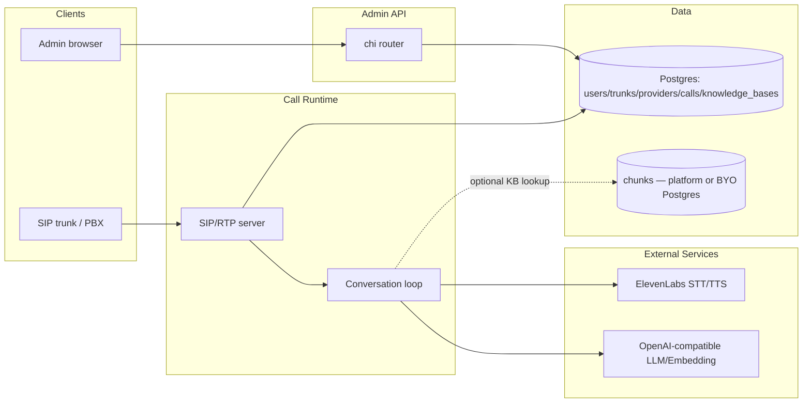
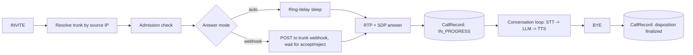

# AgentSIP — AI & Engineering Docs

> Classification: INTERNAL
>
> Hub document. Each topic lives in its own folder under `topics/`. Keep this file short —
> detail lives in the spokes.

## TL;DR

AgentSIP is a voice-agent SIP engine: a Go backend (`backend/`) that terminates SIP calls,
runs an STT→LLM→TTS conversation loop per call, and exposes an admin REST API for
configuring trunks, STT/LLM/TTS providers, and knowledge bases; a React/TailAdmin frontend
(`frontend/`) drives that admin API. Single Postgres datastore (plus an optional separate
bring-your-own Postgres for vector chunks), no queue/async layer, no version prefix on the
API, single-tenant with one seed-admin bootstrap rather than public signup.

## System Overview

## Call Lifecycle

The one domain journey spanning multiple spokes (trunks → providers → calls):

## Topic Index

| Topic | What it covers | Status | Classification | Link |
|---|---|---|---|---|
| Structure | Module map, layering, design patterns | ready | INTERNAL | [topics/structure](topics/structure/README.md) |
| Dependencies | External deps + internal coupling | ready | INTERNAL | [topics/dependencies](topics/dependencies/README.md) |
| Request flow | Inbound HTTP request lifecycle, routing, middleware | ready | INTERNAL | [topics/cross-cutting/request-flow](topics/cross-cutting/request-flow/README.md) |
| Data flow | Stores, encrypted/hashed fields, the ingestion pipeline | ready | CONFIDENTIAL | [topics/cross-cutting/data-flow](topics/cross-cutting/data-flow/README.md) |
| API surface | Full endpoint catalogue + envelope shape | ready | INTERNAL | [topics/cross-cutting/api-surface](topics/cross-cutting/api-surface/README.md) |
| Frontend conventions | TailAdmin/Base UI conventions this repo established | ready | INTERNAL | [topics/cross-cutting/frontend-conventions](topics/cross-cutting/frontend-conventions/README.md) |
| Auth | Login/session/password-reset/profile self-service | ready | CONFIDENTIAL | [topics/auth](topics/auth/README.md) |
| Trunks | SIP trunk CRUD (admin plane) | ready | INTERNAL | [topics/trunks](topics/trunks/README.md) |
| Providers | STT/LLM/TTS provider CRUD (merged, one spoke) | ready | CONFIDENTIAL | [topics/providers](topics/providers/README.md) |
| Knowledge base | KB CRUD + document ingestion (paste + upload) + RAG pipeline | ready | CONFIDENTIAL | [topics/knowledge-base](topics/knowledge-base/README.md) |
| Calls | Full call lifecycle: SIP/RTP engine + call records/decisions/conversation | ready | INTERNAL | [topics/calls](topics/calls/README.md) |

## Enumeration & exclusions

Full candidate list from Phase 0a, so coverage gaps are visible instead of silent.

| Candidate | Decision | Reason |
|---|---|---|
| `backend/cmd/engine`, `backend/internal/{domain,usecase,adapter,config}` | → `structure` | module map |
| `backend/go.mod`, `frontend/package.json` | → `dependencies` | manifest files |
| `backend/internal/adapter/http/{router.go,middleware}` | → `request-flow` | |
| `backend/db/migrations*`, `backend/internal/adapter/repository/postgres`, `backend/internal/pkg/crypto` | → `data-flow` | |
| `backend/internal/adapter/http/handler/*` | → `api-surface` (catalogue) + individual feature spokes (flow detail) | |
| `backend/internal/usecase/auth`, `backend/internal/adapter/mail`, `frontend/.../profile`, `frontend/src/contexts/auth-context.tsx` | → `auth` | mail folded in, only consumer |
| `backend/internal/{domain/trunk.go,usecase/trunk}`, `frontend/.../trunks` | → `trunks` | |
| `backend/internal/usecase/{sttprovider,llmprovider,ttsprovider}`, `frontend/.../{stt,llm,tts}-providers` | → `providers` | merged — ≥40% path/shape overlap |
| `backend/internal/usecase/knowledgebase`, `backend/internal/adapter/{embedder,vectorstore}`, `backend/internal/pkg/textextract`, `backend/db/migrations_vectorstore`, `frontend/.../knowledge-bases` | → `knowledge-base` | textextract + migrations_vectorstore folded in |
| `backend/internal/adapter/sip`, `backend/internal/usecase/{call,conversation}`, `backend/internal/domain/{call.go,turn.go}` | → `calls` | merged — one state machine |
| `frontend/AGENTS.md`, `frontend/src/components/shared/component-card.tsx`, `frontend/src/components/ui/select.tsx` | → `cross-cutting/frontend-conventions` | verifies, doesn't duplicate `frontend/AGENTS.md` |
| `backend/internal/pkg/{apperror,keygen,logging,password}` | folded into `structure`'s module map | one row each, not separate spokes |
| `frontend/src/pages/main/{calendar,coming-soon,forms,tables}` | **excluded** | unrouted TailAdmin demo/template content — zero matching `<Route>` in `App.tsx` |

## How to use this doc

- **Looking for a specific topic?** Pick a row in the Topic Index and open the spoke folder
  — it's self-contained.
- **Editing code?** Flip the spoke's `status` to `stale` if you change a file in its `code:`
  frontmatter and don't update the doc. Reviewer flips back to `ready` after re-verifying.
- **AI agents:** Load only the spoke(s) relevant to your task. For fast orientation on an
  unfamiliar part of the repo, start with `structure` and `dependencies` before a feature spoke.

## Limitations of this doc set

- **This repo is not a git repository.** Every spoke's `verified_commit` is the literal value
  `no-git`. Staleness detection can't diff `verified_commit..HEAD` — it relies entirely on
  manual `status: stale` flips when code changes without a matching doc update. If this repo
  is ever put under git, start using real SHAs for new/re-verified spokes going forward.
- A few open questions surfaced by exploration are recorded as Gotchas in their spoke rather
  than resolved here — notably: whether trunk deletion is ever blocked by a referencing
  resource ([topics/trunks](topics/trunks/README.md)), whether `/calls/{id}/{accept,reject}`
  are meant to require an admin session token or a different webhook-callback auth scheme
  ([topics/cross-cutting/api-surface](topics/cross-cutting/api-surface/README.md)), and
  whether `ConversationTurn` persistence is actually planned or abandoned
  ([topics/calls](topics/calls/README.md)).

## Reference

- [CONVENTIONS.md](CONVENTIONS.md) — doc template, frontmatter, diagram rules, merge rule,
  safety rule.
- [GLOSSARY.md](GLOSSARY.md) — domain terminology and external service names.
