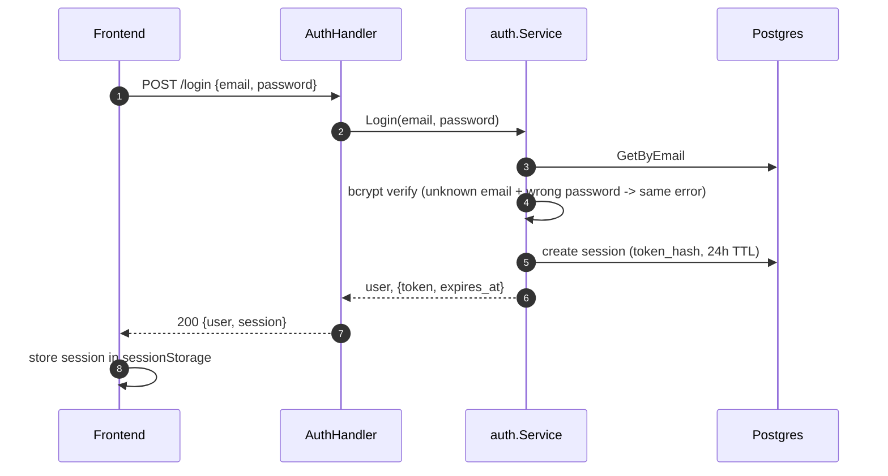

# Auth

> Classification: CONFIDENTIAL — token design and auth internals.

## TL;DR

Single-tenant admin login: a seed-admin bootstrap is the primary way the first user exists,
not public self-serve signup. Session tokens, email-verification tokens, and password-reset
tokens all share one generation/hashing scheme (`internal/pkg/keygen`) with different
prefixes and TTLs. A self-service Profile page lets the signed-in user change their own email
and password without going through the token-based reset flow.

## Entry Points

- `POST /register`, `POST /login`, `POST /logout`, `POST`/`GET /verify-email`,
  `POST /resend-verification`, `POST /password-reset/{request,confirm}`, `GET /me`,
  `PUT /me/email`, `PUT /me/password` — `backend/internal/adapter/http/handler/auth_handler.go:31-50`
- Frontend: `frontend/src/lib/api/auth.ts` (one function per endpoint), consumed by
  `frontend/src/contexts/auth-context.tsx` (session bootstrap, `/me` rehydration, `refreshUser`)
  and `frontend/src/pages/main/profile/index.tsx` (`EmailCard`, `PasswordCard`)

## Sequence — Login

1. `login(email, password)` → `POST /login`, `auth: false` — `frontend/src/lib/api/auth.ts:34`.
2. Handler decodes envelope, calls `svc.Login` — `auth_handler.go:120-137`.
3. `service.Login` normalizes email, looks up user, verifies bcrypt hash; **unknown email and
   wrong password both → `ErrUnauthorized`** (enumeration-safe) — `service.go:160-174`.
4. `startSession` mints a session token (prefix `asis_`, 256-bit random, SHA-256 stored),
   creates a `domain.Session` with 24h TTL — `service.go:183-201`, `keygen.go:17,37-45`.
5. Handler returns `user` + `{token, expires_at}` — `auth_handler.go:93-100,133-136`.
6. Frontend stores the session in `sessionStorage` — `auth.ts:40`, `auth-context.tsx:81-85`.
7. On app mount, `auth-context` bootstraps from `sessionStorage` and calls `GET /me` to
   rehydrate `user` if a non-expired session exists; clears the session if already expired —
   `auth-context.tsx:42-66`.

## Sequence — Password reset via email token

1. `requestPasswordReset(email)` → `POST /password-reset/request`, `auth: false` — `auth.ts:74`.
2. `service.RequestPasswordReset` looks up the user; **always returns nil regardless of
   match** (enumeration-safe) — `service.go:308-322`.
3. If the user exists, `issueAndSendEmailToken` generates a token (prefix `asir_`), stores a
   SHA-256 hash + 1h TTL, emails the link if a Mailer is configured — `service.go:232-269`,
   TTL const `passwordResetTTL` at `service.go:33`.
4. Handler always returns the same generic message — `auth_handler.go:212-228`.
5. `confirmPasswordReset(token, newPassword)` → `POST /password-reset/confirm` — `auth.ts:82`.
6. `service.ResetPassword` validates the new password's length, redeems the token (purpose
   check; used/expired both collapse to `ErrUnauthorized`) — `service.go:324-349,427-449`.
7. Sets the new bcrypt hash, then **`RevokeAllForUser`** — invalidates every existing session,
   since a reset must kill any already-stolen bearer token too — `service.go:340-347`,
   `interfaces.go:53-58`.

## Sequence — Profile self-service (email / password change)

1. `EmailCard` submits `{email, current_password}` → `PUT /me/email` (authenticated) —
   `frontend/src/pages/main/profile/index.tsx:79-95`, `auth.ts:106`.
2. Handler authenticates the bearer token manually (not via middleware, so it can read
   `sess.UserID`) then calls `svc.UpdateEmail` — `auth_handler.go:263-281`.
3. `service.UpdateEmail` verifies `current_password` against the stored hash (`ErrUnauthorized`
   with a "current password is incorrect" detail if wrong — this endpoint is NOT
   enumeration-safe the way login is, since the caller is already authenticated), checks the
   new email isn't already taken, updates — `service.go:362-396`.
4. Frontend calls `refreshUser()` to re-fetch `/me` after success — `profile/index.tsx:84-85`,
   `auth-context.tsx:97-100`.
5. `PasswordCard` submits `{current_password, new_password}` → `PUT /me/password` —
   `profile/index.tsx:167-185`, `auth.ts:116`.
6. `service.ChangePassword` verifies the current password, enforces the minimum length, sets
   the new hash — `service.go:398-425`. **Unlike `ResetPassword`, this does NOT revoke other
   sessions** — the caller already proved both a live session and password possession —
   `service.go:148-151` (doc comment).

## Token design

| Token | Prefix | Storage | TTL |
|---|---|---|---|
| Session | `asis_` | SHA-256 hex digest, never plaintext | 24h (`sessionTTL`) |
| Email verification | `asiv_` | same scheme | 72h (`verifyEmailTTL`) |
| Password reset | `asir_` | same scheme | 1h (`passwordResetTTL`) |

All generated via `internal/pkg/keygen/keygen.go:17,24,25,37-53`: 32 bytes CSPRNG,
base64 RawURLEncoding, prefixed. Email-verify and password-reset tokens share one table
(`EmailTokenRepository`), differentiated by `domain.EmailTokenPurpose`, redeemed through
`redeemEmailToken` which checks purpose + used + expired, all collapsing to
`ErrUnauthorized` (`service.go:427-449` — "none of those distinctions is actionable by
whoever is holding the token").

Passwords: bcrypt, `DefaultCost` (`internal/pkg/password/password.go:17-31`) — deliberately
not a fast digest, contrasted explicitly against `keygen`'s approach in that package's own
doc comment. Minimum length: 8 characters (`minPasswordLength`, `service.go:456`), enforced
in Register/Bootstrap/ResetPassword/ChangePassword — **flagged in the code itself as a
first-cut assumption, not settled policy** (`service.go:454-455`).

## Bootstrap mechanism (seed admin)

- `backend/cmd/engine/main.go:203` calls `authSvc.Bootstrap(ctx, cfg.SeedAdminEmail, cfg.SeedAdminPassword)`
  at process startup.
- Env vars: `SEED_ADMIN_EMAIL`, `SEED_ADMIN_PASSWORD` (`backend/internal/config/config.go:67-68`).
- Idempotent: no-op if email/password are blank, or if `users.Any()` reports any existing
  user; otherwise creates exactly one user via the same path as `Register`, enforcing the
  8-char minimum, and **never creates a session** — `service.go:136-158`.

## Mail degradation (no SMTP configured)

The `Mailer` interface is intentionally minimal (`Send(to, subject, body) error`) so
`usecase/auth` doesn't import `adapter/mail` directly (`interfaces.go:76-85`). `Deps.Mailer`
may be `nil`; every email-sending call site treats send failure/non-configuration as
best-effort and never fails the parent request. `issueAndSendEmailToken` always creates and
stores the token first; only afterward does `if s.mailer == nil { return nil }` skip sending
(`service.go:258-260`). The concrete SMTP adapter reports `ErrNotConfigured` when `Host` is
empty rather than attempting a connection (`adapter/mail/smtp.go:21-24,44,56,62-65`). **Net
effect:** with no SMTP host configured, registration/verification/reset all still succeed and
the token is persisted and redeemable by direct API/link use — the user simply never
receives the mailed copy.

## Failure & State

**Failure — deliberate error collapsing:**
- Login: unknown email vs. wrong password → same `ErrUnauthorized`, to prevent
  email-enumeration via the login endpoint.
- `ResendVerificationEmail` / `RequestPasswordReset`: always the same generic
  success/message regardless of whether the address exists or is already verified.
- `redeemEmailToken` (shared by verify-email and password-reset): unknown token, wrong
  purpose, already-used, and expired all collapse to `ErrUnauthorized`.
- **Exception:** `UpdateEmail`/`ChangePassword` DO surface a specific "current password is
  incorrect" reason, since the caller is already authenticated — not an enumeration risk the
  same way.

**State:** `users`, `sessions`, `email_tokens` tables — see
[../cross-cutting/data-flow/README.md](../cross-cutting/data-flow/README.md) for exact
encrypted/hashed-field mapping.

## Gotchas

- `GET /me`, `PUT /me/email`, `PUT /me/password` are mounted in the **unauthenticated** route
  group in `router.go` but still require a valid session — they self-authenticate inside the
  handler. Don't assume "unauthenticated route" means "no auth check" for these three. See
  [../cross-cutting/request-flow/README.md](../cross-cutting/request-flow/README.md).
- `ChangePassword` intentionally does **not** revoke other sessions (unlike `ResetPassword`)
  — this is by design, not an oversight, because the caller already proved live-session +
  password possession.
- The 8-character minimum password length is explicitly flagged in the code as a first-cut
  assumption — don't treat it as a settled security policy without checking with the team.

## See Also
- [../cross-cutting/request-flow/README.md](../cross-cutting/request-flow/README.md)
- [../cross-cutting/data-flow/README.md](../cross-cutting/data-flow/README.md)
