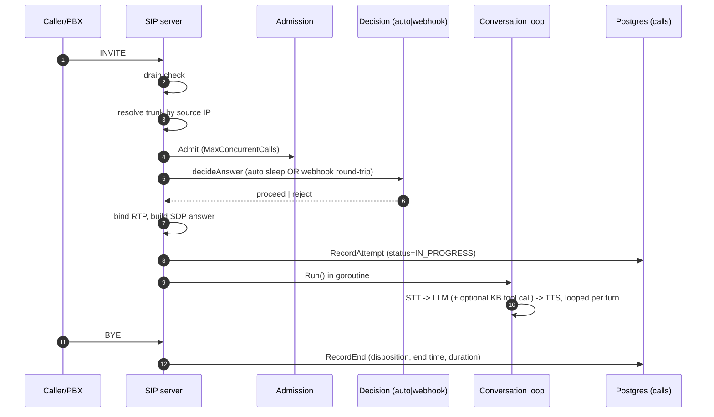

# Calls

## TL;DR

The full call lifecycle, merged into one spoke because it's one state machine: an INVITE
arrives, gets admitted against a trunk's concurrency limit, is answered either automatically
or via a webhook round-trip, gets RTP/SDP set up, runs a conversation loop (STT → LLM → TTS,
with an optional knowledge-base lookup), and ends with a persisted call record. Low-level
SIP/RTP mechanics and the call-record/decision business flow can't be described independently
of each other here.

## Entry Points

- SIP INVITE listener: `handleInvite` (`backend/internal/adapter/sip/server.go:145`),
  registered at `server.go:130`; ACK/BYE at `:131-132`.
- Webhook-mode decision endpoints: `POST /calls/{pendingCallID}/accept`
  (`calldecision_handler.go:31`), `POST /calls/{pendingCallID}/reject` (`:52`).
- Read-only call records: `GET /calls`, `GET /calls/{callID}` (`call_handler.go:28-31`) — not
  part of the lifecycle itself, see [../cross-cutting/api-surface/README.md](../cross-cutting/api-surface/README.md).

## Sequence

1. INVITE arrives → `handleInvite` reads the dialog via `sipgo` (`server.go:150`).
2. **Drain check first**, before any resource allocation (`server.go:159-162`).
3. Trunk resolution by source IP: `trunkSvc.ResolveInbound` (`:169`); no match → SIP 403 (`:172`).
4. Admission control against `MaxConcurrentCalls`, counted **at INVITE time**, before RTP/CDR
   allocation (`admission.go:11-16,44-64`).
5. SDP offer parsed (`:191`); unsupported → 488-equivalent `StatusNotAcceptableHere` (`:195`).
6. Accept/reject decision — `decideAnswer` (`server.go:333-380`), see Webhook decision flow
   below. Runs before any media allocation.
7. On proceed: RTP socket bound (`bindRTPSocket`/`RTPPortAllocator`, `:214`), SDP answer built (`:222`).
8. Call row created: `callSvc.RecordAttempt` (`:232`) → writes a `CallRecord` with
   `Disposition = IN_PROGRESS` (`usecase/call/service.go:46`).
9. Call tracked in `ActiveCalls` for drain bookkeeping (`:246`); `dlg.OnState` registers the
   end-of-dialog teardown closure (`:249-261`): releases admission slot, closes RTP audio,
   releases the port, calls `callSvc.RecordEnd(..., DispositionAnswered, &answerTime)` —
   **disposition is hardcoded to `ANSWERED` here**, because this teardown path only runs for
   calls that got this far.
10. Conversation pipeline started in a goroutine right after session setup, **not gated on
    ACK**: `convoSvc.Run(...)` (`:274-278`) → `usecase/conversation/service.go:51`.
11. `Run` starts an STT session, pumps audio frames into it; a `Final` transcript starts a
    turn (`startTurn`, `service.go:143`). Each turn appends messages to in-memory
    `turnState.messages` — the streamed LLM reply is piped straight into TTS (`respond`,
    `:177-236`), with at most one knowledge-base tool round-trip per turn (`:214-230`).
12. 200 OK sent via `dlg.RespondSDP(answer)`, blocking until ACK (`:284`).
13. Call ends (BYE/transport failure) → `OnState` closure from step 9 fires: admission
    released, RTP torn down, `RecordEnd` persists final disposition/end time/duration
    (`usecase/call/service.go:57-73`).

## Schema

- `domain.CallRecord` (`domain/call.go:30-52`): ID, TrunkID, SIPCallID, CallerNumber,
  CalleeNumber, Direction, Disposition, StartTime, AnswerTime*, EndTime*, DurationSeconds,
  RecordingURL*, timestamps.
- `domain.CallDisposition` enum (`domain/call.go:16-25`): `IN_PROGRESS`, `ANSWERED`, `BUSY`,
  `NO_ANSWER`, `FAILED`, `CANCELLED`.
- `domain.ConversationTurn` (`domain/turn.go:20-29`): ID, CallID, Role (`USER`/`ASSISTANT`),
  Text, StartedAt, LatencyMs*.
- `domain.AnswerMode` enum (`domain/trunk.go:106-125`): `auto`, `webhook`.

## SIP status mapping

| Situation | SIP status | Why |
|---|---|---|
| Trunk at capacity (`ErrTrunkAtCapacity`) | **503 Service Unavailable** (not 486 "Busy Here") | 486 would assert a fact about a *callee* being busy, which is untrue here — there's no human callee, just the trunk being at capacity; 503 is what a carrier/PBX knows how to fail over on. Same reasoning repeated at the drain refusal path. Confirmed by both the reasoning comments (`apperror.go:45-51`, `server.go:183-187`, `drain.go:55-58`) and test assertions (`drain_test.go:36-37`, `call_integration_test.go:415,494-495`). |
| No trunk match for source IP | 403 Forbidden | `server.go:172` |
| Unsupported/unparseable SDP offer | 488-style `StatusNotAcceptableHere` | `server.go:195,228` |
| RTP bind or CDR-create failure after decision accepted | 500 Internal Server Error | `server.go:218,237` |
| Webhook-mode timeout or default reject | 480 Temporarily Unavailable (not 603 Decline) | "nobody actively declined... a different fact than an affirmative no" — `pendingcalls.go:11-16` |
| CANCEL during ring-delay or webhook wait | 487 Request Terminated (sipgo auto-responds) | `decision.go:24-26,46-47`, `server.go:374-376` |

## Webhook decision flow

Entered when `t.AnswerMode == domain.AnswerModeWebhook` (`server.go:335`).

1. A pending call is registered in-memory: `pendingCalls.register()` returns a one-time-use
   buffered channel plus a `forget` cleanup, deferred immediately (`pendingcalls.go:47-60`).
2. SIP 180 Ringing sent, then an HTTP POST fired to the trunk's `WebhookURL`
   (`webhook.go:37-62`, 5s delivery timeout) carrying `PendingCallID`/`TrunkID`/`SIPCallID`/
   caller/callee. Delivery failure (non-2xx or network error) → release the admission slot,
   respond 500.
3. The external system calls back `POST .../accept` or `.../reject` with `pending_call_id`
   from the webhook payload → `Decisions.Accept`/`Reject` → `PendingCalls.Accept`/`Reject` →
   `resolve` sends the decision on the channel. Reject accepts an optional status code
   (300-699, validated in the handler), defaulting to 480 if unset.
4. `waitWebhookDecision` blocks on three events: a decision arrives, the trunk's
   `WebhookTimeoutSeconds` elapses (default 30s, treated as reject+480), or the caller sends
   CANCEL (reported separately — sipgo already answered the CANCEL with 487 on its own).
5. **Single-decision-only**: `resolve` uses a `sync.Once` per pending call — a second
   accept/reject call for the same `pendingCallID` returns `apperror.ErrCallDecisionAlreadyMade`.
   After the wait ends (any outcome), the `forget` cleanup deletes the pending-call entry, so
   a decision arriving after that point returns `apperror.ErrNotFound` instead of silently
   resolving into nothing — this also covers the timeout case.
6. **Auto mode**, by contrast: no webhook, no HTTP round trip — `decideAnswer`'s default
   branch just sleeps for `RingDelaySeconds` (0 = answer immediately) while watching for
   CANCEL, then proceeds.

## Failure & State

**Graceful drain** (`backend/internal/adapter/sip/drain.go`): `StartDraining()` flips an
atomic flag checked first-thing in `handleInvite`, so new INVITEs are refused with 503 +
`Retry-After: 10` — existing calls are untouched. `WaitForCalls(ctx)` polls `ActiveCalls.Count()`
every 250ms until zero or the deadline. If calls remain at the deadline, `HangupRemaining(ctx)`
sends a BYE to each live dialog with a fresh 5s context, rather than just closing the
transport, so the far end releases its own resources instead of hanging on silence. `Drain`
composes all three and returns the count of calls cut short (0 = "nobody lost a
conversation"). Transport close is left to the caller after `Drain` returns.

**Idempotent teardown**: mid-call teardown races are made safe throughout — `Admission`'s
release uses `sync.Once`; `ActiveCalls.add`'s removal func is a no-op on an already-deleted
key; `rtpAudioIO.closeHangup` uses `sync.Once` since both a BYE and a transport read failure
can each try to close it.

**State persistence**: in-memory only, reset on process restart — `Admission` (concurrency
counts), `PendingCalls` (webhook decisions awaiting callback), `ActiveCalls` (live dialogs for
drain bookkeeping), `RTPPortAllocator`, and `turnState.messages` (LLM chat history, held only
for the lifetime of `Service.Run` — **nothing in the conversation loop is written to
Postgres**, see Gotchas). Persisted to Postgres: the `CallRecord` row, created at INVITE-accept
time (`Disposition=IN_PROGRESS`), finalized exactly once via `UpdateDisposition` when the
dialog ends — the repository doc comment calls this "the one-time terminal write"
(`usecase/call/interfaces.go:25-27`).

## Gotchas

- **`domain.ConversationTurn` has no repository, service, or persistence call site anywhere
  in the backend.** Its own doc comment describes it as "persisted for transcript review and
  QA," but conversation turns today exist only as in-memory `LLMMessage` history inside
  `turnState` — nothing is written to the `turns` table. Treat any claim that transcripts are
  queryable/durable as false until this is actually implemented.
- **`BUSY`/`NO_ANSWER`/`FAILED`/`CANCELLED` dispositions are defined but the only confirmed
  `RecordEnd` call site always passes `DispositionAnswered` hardcoded.** It's possible another
  call site sets the other dispositions for calls that never got far enough to reach the
  `dlg.OnState` registration, but this wasn't located during exploration — don't assume the
  other four disposition values are actually reachable without checking further.
- Trunk-at-capacity maps to SIP **503**, not 486 — if you're searching the code or writing
  anything that assumes 486 "Busy Here" semantics for this case, it's wrong; the reasoning is
  deliberate and documented in three separate places in the code.
- The conversation loop starts **before ACK**, not after — a race between "call answered" and
  "first audio frame processed" is possible by design, not a bug, if observed.

## See Also
- [../trunks/README.md](../trunks/README.md)
- [../cross-cutting/data-flow/README.md](../cross-cutting/data-flow/README.md)
