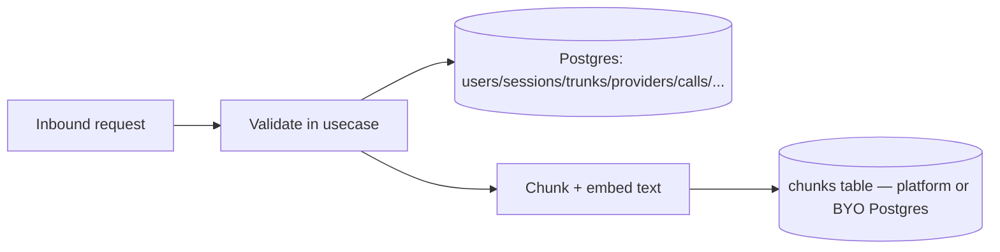

# Data Flow

> Classification escalated to CONFIDENTIAL: this topic describes exactly which columns hold
> encrypted secrets and how auth tokens/passwords are hashed — auth/token internals per
> CONVENTIONS.md's escalation rule.

## TL;DR

One Postgres schema (`backend/db/migrations`) plus one optional, separately-provisioned
vector-store schema (`backend/db/migrations_vectorstore`) for a bring-your-own pgvector
Postgres. All writes are synchronous within the request — there is no queue/async layer
anywhere in this backend today (explicitly deferred, see below).

## Flow

## Stores & their owners

| Store | What it holds | Writers | Readers |
|---|---|---|---|
| `users` | Account identity + bcrypt password hash | `user_repo.go:25,74,83,92` | `user_repo.go:39,57,104` |
| `sessions` | Bearer-session records, only sha256 `token_hash` stored | `session_repo.go:26,56,65` | `session_repo.go:39` |
| `email_tokens` | verify-email / password-reset tokens, only `token_hash` stored | `emailtoken_repo.go:25,58` | `emailtoken_repo.go:39` |
| `stt_providers` / `llm_providers` / `tts_providers` | Provider configs incl. field-encrypted `api_key` | `{stt,llm,tts}provider_repo.go:31,75,91` | same files `:48,57` |
| `trunks` | SIP trunk config, FK to the three provider tables (`ON DELETE RESTRICT`), field-encrypted `sip_digest_password`, max 3 per deployment | `trunk_repo.go:35,107,141` | `trunk_repo.go:73,79,152` (`FindByInboundMatch` — the SIP hot path) |
| `calls` | Call records, FK `trunk_id` → `trunks` `ON DELETE CASCADE` | `call_repo.go:38,104` | `call_repo.go:56,61,66` |
| `turns` | Per-call conversation turns, FK `call_id` → `calls` `ON DELETE CASCADE` | **none found** — see [../../calls/README.md](../../calls/README.md) Gotchas | **none found** |
| `knowledge_bases` | RAG KB config incl. field-encrypted `embedding_api_key` and `vector_store_dsn`; empty `vector_store_provider` = platform-managed store | `knowledgebase_repo.go:31` | `knowledgebase_repo.go:66,75` |
| `documents` | KB document metadata/status, FK `knowledge_base_id` → `knowledge_bases` `ON DELETE CASCADE` | `knowledgebase_repo.go:120,131` | `knowledgebase_repo.go:143,164` |
| `chunks` (separate migration, `backend/db/migrations_vectorstore/0001_vectorstore.up.sql`) | Chunked text + `vector(1536)` embedding per document/KB; **no DB-level FKs** — consistency enforced in application code since it may live on a different Postgres instance entirely | `pgvector/client.go:121` (Upsert), `:149` (DeleteByDocument) | `pgvector/client.go:160` (cosine-distance Search) |

## Encrypted fields (AES-256-GCM, `backend/internal/pkg/crypto/fieldcrypt.go:16-56`)

| Field | Encrypt | Decrypt |
|---|---|---|
| `stt_providers.api_key` | `sttprovider_repo.go:32,76` | `:118` |
| `llm_providers.api_key` | `llmprovider_repo.go:32,76` | `:114` |
| `tts_providers.api_key` | `ttsprovider_repo.go:32,76` | `:114` |
| `trunks.sip_digest_password` | `trunk_repo.go:36,108` | `:216` |
| `knowledge_bases.embedding_api_key` | `knowledgebase_repo.go:32` | `:105` |
| `knowledge_bases.vector_store_dsn` | `knowledgebase_repo.go:36` | `:111` |

A trunk's read path also decrypts the *embedded* STT/LLM/TTS API keys it resolves via the
FK join (`trunk_repo.go:219,222,225`) — see [../../trunks/README.md](../../trunks/README.md).

## Hashed (not reversible) fields

| Field | Scheme |
|---|---|
| `users.password_hash` | bcrypt (`backend/internal/pkg/password`) |
| `sessions.token_hash` | SHA-256 hex of the bearer token (`internal/pkg/keygen`) — plaintext never stored |
| `email_tokens.token_hash` | Same SHA-256 scheme as sessions |

## Async handoffs

**None found.** Ingestion (chunk → embed → store) and every repository write run
synchronously inside the request. This is a deliberate v1 choice, explicitly documented:
`backend/internal/usecase/knowledgebase/service.go:86-94` notes a future asynq-based worker
is the intended path for large corpora, but it is not implemented today.

## Knowledge-base ingestion pipeline (the one non-trivial data-flow in this codebase)

1. Text in — paste (`knowledgebase_handler.go:197`) or multipart upload, extracted via
   `textextract.ExtractPDF`/`Sanitize` for `.pdf` (`uploadDocument`, `:228-295`).
2. Document row created with `status=PROCESSING` (`usecase/knowledgebase/service.go:102-112`).
3. Chunk: `s.chunker.Chunk(text)` (`service.go:131`, `chunker.go:33` — overlapping char windows).
4. Embed: `s.embedder.Embed(ctx, kb.Embedding, texts)` (`service.go:136`) via
   `adapter/llm/openaicompat`.
5. Store: `vectorStore.Upsert` (`service.go:144-158`) — destination is per-KB: empty
   `vector_store_provider` → platform-managed Postgres; otherwise the decrypted bring-your-own
   DSN, routed via `pgvector/client.go:60` (`poolFor`).
6. Document marked `READY` or `FAILED` (`service.go:116,123`).

See [../../knowledge-base/README.md](../../knowledge-base/README.md) for the full flow
including both ingest entry points and failure semantics.

## See Also
- [../request-flow/README.md](../request-flow/README.md)
- [../../auth/README.md](../../auth/README.md)
- [../../knowledge-base/README.md](../../knowledge-base/README.md)
