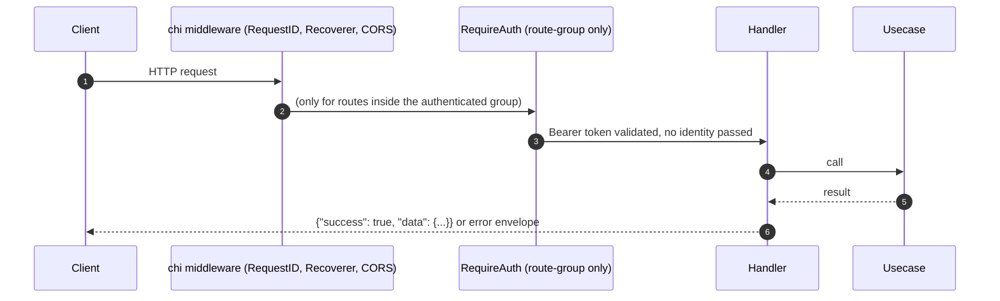

# Request Flow

## TL;DR

The admin API is a single `chi` router (`backend/internal/adapter/http/router.go`). Three
middlewares apply globally (RequestID, Recoverer, CORS); `RequireAuth` applies only inside
one route group, not globally. A handful of auth-adjacent endpoints (`logout`, `/me`,
`/me/email`, `/me/password`) deliberately bypass `RequireAuth` and authenticate themselves,
because that middleware validates a token but never exposes the resolved identity.

## Sequence

## Middleware stack (in order)

| Order | Middleware | Role | File |
|---|---|---|---|
| 1 | `chimw.RequestID` | stdlib chi middleware, tags request with an ID | `backend/internal/adapter/http/router.go:41` |
| 2 | `chimw.Recoverer` | Recovers panics in handlers into 500s | `backend/internal/adapter/http/router.go:42` |
| 3 | `middleware.CORS(deps.CORSAllowedOrigins)` | Sets CORS headers; reflects Origin if allowlist is empty, else restricts; answers OPTIONS preflight directly (204). Safe to reflect Origin because auth is Bearer-token-only, not cookie-based (doc comment) | `backend/internal/adapter/http/middleware/cors.go:15` |
| 4 | `middleware.RequireAuth(credentials)` | Applied **only** inside the authenticated route group (not globally). Reads `Authorization: Bearer`, calls `Authenticator.Authenticate`, writes `apperror.ErrUnauthorized`/other on failure, else calls `next` — with **no identity threaded into request context** ("no per-request identity to thread through context", doc comment) | `backend/internal/adapter/http/middleware/auth.go:23` |

## Routing groups

**Unauthenticated** (mounted at root, before the authenticated group):
- `GET /healthz` → `handler.Health`
- `AuthHandler.Routes` mounted at root: `/register`, `/login`, `/logout`, `/verify-email`
  (GET+POST), `/resend-verification`, `/password-reset/request`, `/password-reset/confirm`,
  `/me`, `/me/email`, `/me/password`

**Authenticated** (behind `middleware.RequireAuth`, `backend/internal/adapter/http/router.go:53-65`):
- `/stt-providers`, `/llm-providers`, `/tts-providers`, `/trunks`, `/knowledge-bases`, `/calls`
  (the last mounts both `CallHandler` and `CallDecisionHandler` on the same sub-router)

## Terminal handlers

| Handler | Example |
|---|---|
| `TrunkHandler` | `h.svc.Create(r.Context(), t)` (`backend/internal/adapter/http/handler/trunk_handler.go:185`) → `usecase/trunk.Service.Create` |
| `CallHandler` | `h.svc.Get(r.Context(), id)` (`call_handler.go:107`); list uses cursor-based pagination (`call.Page`, "Before" param) deliberately instead of offset, since calls arrive continuously |
| `AuthHandler` | `login()` (`auth_handler.go:127`) → `h.svc.Login(ctx, email, password)`, response built via `toIssuedSessionResponse` — the only response shape that ever carries a plaintext session token |

## Special cases: handlers that bypass `RequireAuth`

| Path | Why |
|---|---|
| `logout` (`auth_handler.go:139-151`) | Reads the Bearer token directly instead of going through `RequireAuth`, so an already-expired/revoked token can still log out cleanly instead of being rejected by the middleware first |
| `authenticate()` helper (`auth_handler.go:55-67`), used by `me()` (:244), `updateEmail()` (:263), `changePassword()` (:288) | These three need the resolved `*domain.Session` (specifically `sess.UserID`) to act on. `RequireAuth` only returns pass/fail with no identity in context, so these handlers call `h.svc.Authenticate` themselves |

Functionally, `/me`, `/me/email`, `/me/password` still require a valid session token — they
just enforce it inside the handler rather than via the shared middleware.

## See Also
- [../api-surface/README.md](../api-surface/README.md)
- [../data-flow/README.md](../data-flow/README.md)
- [../../auth/README.md](../../auth/README.md)
