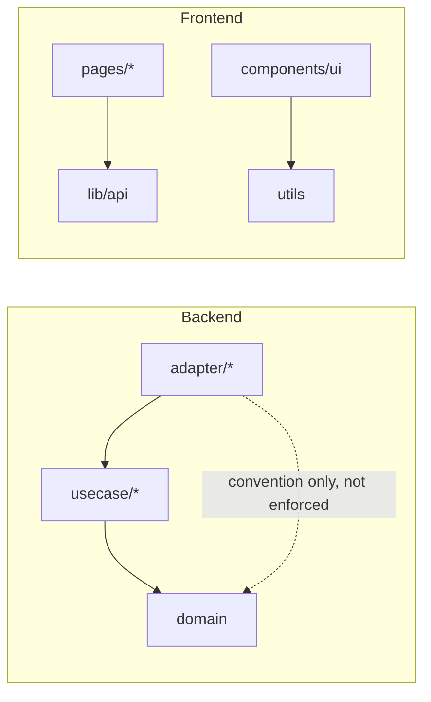

# Dependencies

## TL;DR

Backend: Go, chi router, pgx/v5 for Postgres, a handful of provider-specific SIP/RTP/SDP and
PDF-extraction libraries. Frontend: React 19 + Vite + TailAdmin's Base UI component kit +
react-hook-form/zod. No dependency-boundary lint rule exists on either side — internal
coupling is convention-only (see [../structure](../structure/README.md)).

## External dependencies

### Go (`backend/go.mod`)

| Package | Purpose (as used here) | Notes |
|---|---|---|
| `github.com/go-chi/chi/v5` | HTTP router/middleware for the whole admin REST API | — |
| `github.com/jackc/pgx/v5` | Postgres driver/connection pool, used in every `adapter/repository/postgres/*.go` file | — |
| `github.com/jackc/pgconn` | Postgres error typing (`*pgconn.PgError`) for FK-violation mapping (e.g. `trunk_repo.go`) | transitive via pgx/v5, no direct `require` line |
| `github.com/google/uuid` | UUID primary keys/identifiers across repos and handlers | — |
| `github.com/ledongthuc/pdf` | PDF plain-text extraction, sole use in `backend/internal/pkg/textextract/textextract.go:14` | pseudo-version pin; its commit timestamp looked "future-dated" to one scout only because this sandbox's clock is set to 2026 — not a real anomaly |
| `github.com/gorilla/websocket` | Outbound WebSocket client to ElevenLabs STT/TTS streaming APIs (`adapter/stt/elevenlabs`, `adapter/tts/elevenlabs`) | not used for any backend-hosted WS server |
| `github.com/pgvector/pgvector-go` (+ `/pgx`) | Vector type + pgx integration for embedding storage/search | — |
| `github.com/emiago/sipgo`, `github.com/pion/rtp`, `github.com/pion/sdp/v3` | SIP/RTP/SDP protocol handling for the live call engine (`adapter/sip`) | core to `cmd/engine`, outside the original dependency checklist but load-bearing |

**Schema migrations are NOT managed by a Go library** — no `golang-migrate` (or similar)
import exists anywhere in `backend`. Schema is plain SQL under `backend/db/migrations` and
`backend/db/migrations_vectorstore`, applied externally. The vector-store client explicitly
treats a bring-your-own Postgres's schema as "the operator's to own, not ours to migrate by
hand" (`backend/internal/adapter/vectorstore/pgvector/client.go:56`).

### Frontend (`frontend/package.json`)

| Package | Purpose (as used here) |
|---|---|
| `react` / `react-dom` | Core UI library |
| `react-router` (v8, not `react-router-dom`) | Client-side routing |
| `react-hook-form` | Form state management across all feature forms |
| `zod` | Schema validation paired with `react-hook-form` via colocated `schema.ts` files |
| `@hookform/resolvers` | Bridges zod schemas into react-hook-form validation |
| `i18next` / `react-i18next` | Internationalization (`frontend/src/i18n`, `frontend/src/messages/{en,es,de,ar}.json`) |
| `@base-ui/react` | Headless UI primitives underlying `frontend/src/components/ui/*` |
| `class-variance-authority` | Variant-based className composition for UI components |
| `react-dropzone` | Drag-and-drop file upload (knowledge-base document upload) |
| `tailwindcss` (+ `@tailwindcss/vite`, `@tailwindcss/forms`) | Utility-first CSS |
| `vite` | Dev server + build tool |

## Internal coupling

- `internal/usecase/*` → `internal/domain`: confirmed across all 6 usecase packages.
- `internal/adapter/*` → `internal/usecase/*`: confirmed (postgres repos, HTTP handlers, the
  LLM adapter client all import their matching usecase package).
- `internal/domain` → anything else: none found — domain stays dependency-free, including in
  its own doc comments (which only *mention* usecase/adapter in prose, not in actual imports).
- Frontend `pages/*` → `lib/api`: confirmed in 29+ files.
- Frontend `components/ui/*` → `utils` (`cn()`): confirmed in 38 files.

## Forbidden imports

None found — no `golangci-lint`/`depguard` config, no ESLint import-boundary rule, and no
dedicated architecture test enforcing import direction on either side of the repo.

## See Also
- [../structure/README.md](../structure/README.md)
