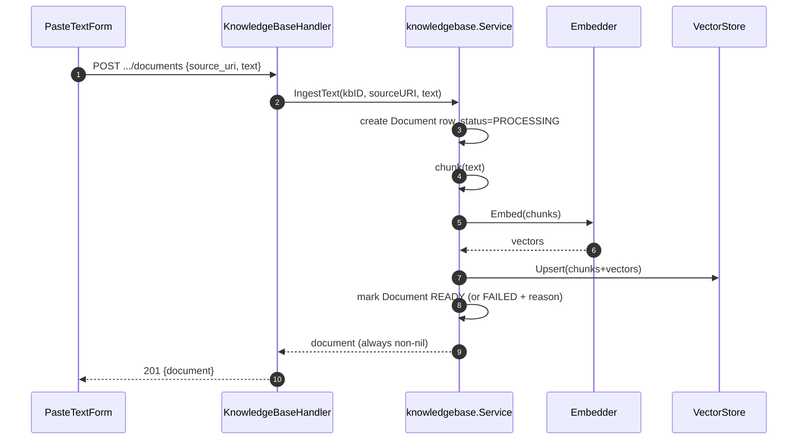

# Knowledge Base

> Classification: CONFIDENTIAL — describes embedding-API-key and vector-store-DSN encryption.

## TL;DR

A knowledge base is a RAG resource: name + embedding-provider config + vector-store config
(platform-managed or bring-your-own Postgres). Documents enter it two ways — paste raw text,
or upload a `.pdf`/`.txt`/`.md` file (extracted + sanitized server-side) — both funneling into
the same chunk→embed→store pipeline. A document's ingestion outcome (`READY`/`FAILED`) is
reported in the row itself, not as an HTTP error — the request always succeeds if the
document record was created.

## Entry Points

- `POST /knowledge-bases`, `GET /knowledge-bases`, `GET /knowledge-bases/{id}` —
  `knowledgebase_handler.go:105,132,146`
- `POST /knowledge-bases/{id}/documents` — paste-text ingest (`:197`)
- `POST /knowledge-bases/{id}/documents/upload` — multipart file upload (`:233`)
- `GET /knowledge-bases/{id}/documents` — list (`:161`)
- Frontend: `frontend/src/pages/main/knowledge-bases/detail/ingest-document-dialog.tsx` — the
  one remaining **dialog**-based flow in the app (see
  [../cross-cutting/frontend-conventions/README.md](../cross-cutting/frontend-conventions/README.md)),
  with two tabs: `PasteTextForm` and `UploadFileForm`.

## Sequence — paste-text ingest



1. `PasteTextForm` submits → `knowledgeBasesApi.ingestDocument` POSTs JSON
   `{source_uri, text}` — `frontend/src/lib/api/knowledge-bases.ts:47`.
2. Handler decodes, validates `text != ""`, calls `svc.IngestText(ctx, kbID, sourceURI, text)`
   — `knowledgebase_handler.go:197-214`.
3. `Service.IngestText` loads the KB, creates a `Document` row with `status=PROCESSING`, then
   calls `chunkEmbedAndStore` — `usecase/knowledgebase/service.go:95-114`.
4. On failure, status is set to `FAILED` with a `failure_reason` and the non-nil doc is still
   returned alongside a wrapped error — `service.go:116-120`. On success, status → `READY`
   (`:123-127`).
5. Handler returns **HTTP 201 regardless of ingestion outcome**, since `doc != nil` — the
   frontend checks `document.status === "FAILED"` explicitly (see Failure semantics below).

## Sequence — file upload (multipart → extract → sanitize → ingest)

1. `UploadFileForm` collects a file via `react-dropzone` (client-side `maxSize` 20MB,
   accepted `.pdf`/`.txt`/`.md`), calls `knowledgeBasesApi.uploadDocument(kbId, file, sourceUri)`
   which builds `FormData` and POSTs via `apiRequestFormData` — no JSON envelope, no manual
   `Content-Type` (the browser sets the multipart boundary) — `client.ts:151-166`.
2. Handler wraps the body in `http.MaxBytesReader` at `maxUploadFileSize+1MiB`, parses the
   multipart form bounded at `maxUploadFileSize` — `knowledgebase_handler.go:242-243`.
3. Reads the `file` field, checks the extension against `allowedUploadExtensions`, reads all
   bytes — `:250-269`.
4. If `.pdf`: `textextract.ExtractPDF(data)` (panic-recovering wrapper around
   `github.com/ledongthuc/pdf`, `textextract.go:21-42`). Otherwise raw bytes are text directly.
5. `textextract.Sanitize(rawText)` — if the result is empty, returns a validation error "no
   extractable text was found in this file" (`:283-288`).
6. `sourceURI` defaults to the original filename if the form field is blank; calls the same
   `svc.IngestText` as the paste-text path.
7. Same 201-with-possibly-`FAILED`-status response semantics as paste-text.

## Chunk + embed + store (shared by both ingest paths)

1. `s.chunker.Chunk(text)` splits into overlapping char-window chunks; zero chunks is an
   error — "document has no content to ingest" (`service.go:130-134`).
2. `s.embedder.Embed(ctx, kb.Embedding, texts)` calls the embedding provider
   (`adapter/embedder/openaicompat/client.go`); vector-count mismatch is an error
   (`service.go:136-142`). The adapter POSTs `{model, input}` to `<base_url>/embeddings`, and
   re-orders response vectors by the provider's returned `index` rather than trusting array
   order (`client.go:75-84`).
3. Builds `domain.Chunk` structs, calls `vectorStore.Upsert` (`service.go:144-158`).
4. `pgvector/client.go` — `Upsert` batch-inserts into `chunks`; `Search` does
   `ORDER BY embedding <=> $2 LIMIT $3` cosine-distance search filtered by `knowledge_base_id`.

## Schema

- `knowledge_bases` (`backend/db/migrations/0001_init.up.sql:194-213`): id, name,
  embedding_provider, embedding_base_url, embedding_api_key (encrypted), embedding_model,
  vector_store_provider (empty = platform-managed), vector_store_dsn (encrypted), timestamps.
- `documents` (`:215-223`): id, knowledge_base_id (FK `ON DELETE CASCADE`), source_uri,
  status, failure_reason (nullable), timestamps.
- `chunks` (separate migration, `backend/db/migrations_vectorstore/0001_vectorstore.up.sql`):
  id, document_id, knowledge_base_id (**no DB-level FKs** — may live on a different Postgres
  instance entirely, consistency enforced in application code), chunk_index, content,
  `embedding vector(1536)` (dimension flagged in the migration itself as an assumption that
  must match the configured embedder). HNSW cosine-ops index on `embedding`.

## Sanitization rules (`backend/internal/pkg/textextract/textextract.go:56-91`)

- `strings.ToValidUTF8` strips invalid UTF-8 byte sequences.
- Trims a leading UTF-8 BOM.
- Normalizes line endings (`\r\n`/`\r` → `\n`) and the PDF page-break marker `\f` → `\n`.
- Removes all Unicode control characters except `\n`/`\t`.
- Trims trailing whitespace per line, collapses runs of 2+ blank lines down to 1.
- Never alters actual wording, never panics (doc comment, `:49`). Any non-visible embedded
  PDF content (form fields/attachments/OCR artifacts) is filtered out only as a side effect
  of control-byte stripping — `GetPlainText` only ever returns rendered text in the first
  place, so there's no separate attachment stream to worry about.

## Upload constraints

| Constraint | Value | Enforced |
|---|---|---|
| Max file size | 20 MiB | Backend (`MaxBytesReader`+`ParseMultipartForm`) **and** frontend (`react-dropzone` `maxSize`) independently |
| Allowed extensions | `.pdf`, `.txt`, `.md` | Same — backend is authoritative, frontend is UX only |

## Failure & State

**The "201 + status FAILED is not a transport error" pattern** (handler comment,
`knowledgebase_handler.go:219-224`): *"A non-nil doc with a non-nil err means ingestion
reached the document row but failed partway through... That's still a successful API call —
the document exists, with its Status/FailureReason reporting what happened — not a
protocol-level error."*

Two distinct failure tiers:
1. **Pre-ingestion validation** (returns a real HTTP error, no document created): bad file
   extension, oversized file, PDF extraction failure (encrypted/scanned/corrupted), or
   sanitized text is empty.
2. **Post-ingestion failure** (document created, status=`FAILED`, HTTP 201 still returned):
   embedding provider rejects the request (e.g. bad API key) → `"embed chunks: %w"`; chunker
   returns zero chunks → `"document has no content to ingest"`.

Frontend treats both ingest paths identically: checks `document.status === "FAILED"` after a
successful 201 response and surfaces `document.failure_reason` in a non-blocking alert —
explicitly not a thrown/caught error.

**State:** knowledge-base/document rows persist synchronously (see
[../cross-cutting/data-flow/README.md](../cross-cutting/data-flow/README.md)) — there is no
async/background ingestion worker today.

## Vector store modes

- Branch point: `domain.VectorStoreConfig.DSN == ""` (`pgvector/client.go:61-63`) — empty DSN
  uses the platform's shared pool (`config.VectorStoreDatabaseURL`); non-empty DSN lazily
  creates and caches a per-DSN pool, registers pgvector types, and idempotently provisions the
  `chunks` schema via `CREATE ... IF NOT EXISTS` since a custom Postgres is "the operator's to
  own, not ours to migrate by hand."
- Config origin: an empty/omitted `vector_store` object at KB-creation time means
  platform-managed; setting `provider: "pgvector"` + `dsn` brings your own Postgres.

## Data

```json
// Ingest response (either path — paste-text or upload)
{ "document": { "id": "<uuid>", "knowledge_base_id": "<uuid>", "source_uri": "<string>",
                "status": "READY" | "PROCESSING" | "FAILED", "failure_reason": null | "<string>" } }
```

## Gotchas

- A 201 response does **not** mean ingestion succeeded — always check `document.status`
  before treating an ingest/upload call as done. This trips up anyone assuming REST status
  codes alone tell the whole story.
- No HTTP route for re-ingestion or document deletion was found, even though
  `pgvector/client.go`'s `DeleteByDocument` exists at the store layer — if you need to remove
  a document's chunks, this gap is worth confirming/filling rather than assuming it's wired up.
- `embedding vector(1536)` is a fixed dimension baked into the migration — swapping to an
  embedding model with a different output dimension requires a migration change, not just a
  config change.

## See Also
- [../cross-cutting/data-flow/README.md](../cross-cutting/data-flow/README.md)
- [../trunks/README.md](../trunks/README.md)
