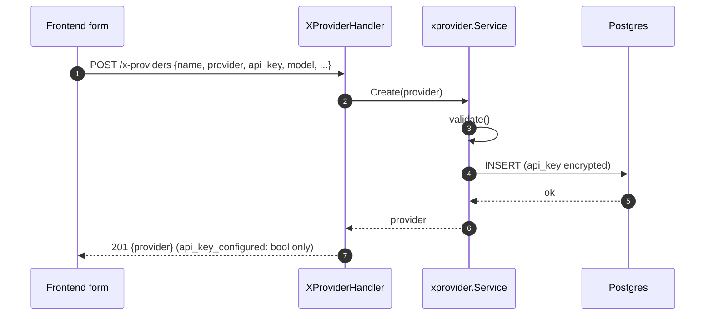

# Providers (STT / LLM / TTS)

> Classification: CONFIDENTIAL — describes how provider API keys are encrypted at rest and
> never echoed back.

## TL;DR

Three standalone, reusable provider-config resources — deliberately near-identical in shape,
documented here as **one merged spoke** per the merge rule (their `code:` path sets overlap
far above the 40% threshold, and the three services are three implementations of exactly the
same sequence). Each is referenced by ID from a trunk, never inlined into it — see
[../trunks/README.md](../trunks/README.md).

## Entry Points

| Kind | Routes | Handler | Usecase | Repo |
|---|---|---|---|---|
| STT | `/stt-providers[/{id}]` | `sttprovider_handler.go:24-30` | `usecase/sttprovider/service.go` | `sttprovider_repo.go` |
| LLM | `/llm-providers[/{id}]` | `llmprovider_handler.go` | `usecase/llmprovider/service.go` | `llmprovider_repo.go` |
| TTS | `/tts-providers[/{id}]` | `ttsprovider_handler.go` | `usecase/ttsprovider/service.go` | `ttsprovider_repo.go` |

All three: `POST /`, `GET /`, `GET /{id}`, `PUT /{id}`, `DELETE /{id}`. Wired in
`backend/cmd/engine/main.go:139-141`. Frontend: one list/new/edit page set per kind under
`frontend/src/pages/main/{stt,llm,tts}-providers/`.

## Sequence — Create (representative of all three)



1. Frontend form validates via a Zod schema, omits `api_key` from the request if left blank.
2. Handler decodes the envelope, maps to the domain struct with `ID: uuid.Nil` —
   `sttprovider_handler.go:63-71,73-86`.
3. Usecase `Create`: runs `validate(p)`, assigns `uuid.New()` + timestamps, calls
   `repo.Create` — `usecase/sttprovider/service.go:22-35`.
4. Repo `Create`: encrypts `APIKey` via the field cipher, inserts the row —
   `sttprovider_repo.go:31-44`.
5. Handler returns the response DTO — the API key is represented only as
   `api_key_configured: bool`, never echoed — `sttprovider_handler.go:39-61`.

## Per-kind differences

| Field | STT | LLM | TTS |
|---|---|---|---|
| `Provider` (kind enum) | yes | yes | yes |
| `APIKey` | yes | yes | yes |
| `Model` | yes | yes | yes |
| `BaseURL` | — | yes, **required** | — |
| `VoiceID` | — | — | yes |
| Extra backend validation | none beyond common | `base_url` required (`llmprovider/service.go:81-82`) | none beyond common |
| Common validation (all 3) | `name`, `provider` required; STT also requires `model`; TTS requires only `name`+`provider` (no required `model`/`voice_id`) | | |
| Frontend's allowed `provider` value | `elevenlabs` only | `openai_compatible` only | `elevenlabs` only |

Domain struct definitions: `backend/internal/domain/trunk.go:68-104`
(`STTProvider`/`LLMProvider`/`LLMProvider` adds `BaseURL`, `TTSProvider` adds `VoiceID`).

## Secret handling

- API key is **field-encrypted at rest** via `crypto.FieldCipher` (AES-256-GCM — see
  [../cross-cutting/data-flow/README.md](../cross-cutting/data-flow/README.md)).
- Encrypt on write: `sttprovider_repo.go:32-35` (Create), `:76-79` (Update) — identical
  pattern in the LLM/TTS repos.
- Decrypt on read: `sttprovider_repo.go:112-124`.
- **Never echoed back**: the response DTO always substitutes `APIKeyConfigured bool = (p.APIKey != "")`
  for the real key — `sttprovider_handler.go:39-49,51-61`, same in the LLM/TTS handlers.
- **PUT is full-replace, not merge**: a blank `api_key` in an update request *clears* the
  stored secret — there's no "leave it unchanged" path. The frontend surfaces an explicit
  warning banner about this (`frontend/src/pages/main/stt-providers/form.tsx:67-73`).

## Referenced by

Only `trunks` hold these as foreign keys — confirmed via grep, no other table (including
knowledge bases, which have their own unrelated "embedding provider" concept) references
`stt_providers`/`llm_providers`/`tts_providers`:

- `Trunk.STTProviderID`/`LLMProviderID`/`TTSProviderID` (`domain/trunk.go:161-163`), resolved
  into embedded config at read time (comment at `:150-154`).
- DB migration FKs: `backend/db/migrations/0001_init.up.sql:108-110`, all
  `REFERENCES ... ON DELETE RESTRICT`.
- **Delete is blocked (not cascaded) while in use**: each repo's `Delete` catches Postgres
  FK-violation code `23503` and returns a 409 conflict ("this X provider is still in use by
  one or more trunks") — `sttprovider_repo.go:91-110`, same pattern in LLM/TTS repos.

## Restricted provider-kind choices

**Frontend-only, not enforced by the backend.** The backend's `domain.ProviderKind` type
allows a wider set of values than the UI currently offers — each `validate()` only checks
`Provider != ""`, it doesn't restrict to a specific kind:

- STT: `z.enum(["elevenlabs"])` (`frontend/src/pages/main/stt-providers/schema.ts:6-10`,
  comment at `:4-5` explicitly notes this is a UI restriction, not a type limit).
- TTS: same, `z.enum(["elevenlabs"])`.
- LLM: `z.enum(["openai_compatible"])`.

## Data

```json
// STT create
{ "name": "ElevenLabs — Prod", "provider": "elevenlabs", "api_key": "<redacted>", "model": "scribe_v1" }

// LLM create (note extra base_url)
{ "name": "OpenAI Prod", "provider": "openai_compatible", "base_url": "https://api.openai.com/v1", "api_key": "<redacted>", "model": "gpt-4o" }

// TTS create (note extra voice_id)
{ "name": "ElevenLabs Voice", "provider": "elevenlabs", "api_key": "<redacted>", "voice_id": "<voice-id>", "model": "eleven_turbo_v2" }
```

Response shape (all three): same fields minus `api_key`, plus `id`,
`api_key_configured: true|false`, `created_at`, `updated_at`.

## Gotchas

- A `PUT` with a blank `api_key` clears the secret — this is a full-replace semantic shared
  with trunks and knowledge bases, not a provider-specific quirk. Always warn the user in any
  UI before submitting an edit form with an empty secret field.
- The backend will happily accept a `provider` value the frontend doesn't currently offer
  (e.g. `pgvector` as an STT provider kind) — the restriction to ElevenLabs/OpenAI-compatible
  is a UI choice, not a contract guarantee. Don't assume the backend rejects other values.
- Deleting a provider that's still referenced by a trunk returns 409, not 204 — this is the
  one FK-violation-to-Conflict mapping confirmed to exist in this part of the codebase (unlike
  trunks' own delete path, see [../trunks/README.md](../trunks/README.md) Gotchas).

## See Also
- [../trunks/README.md](../trunks/README.md)
- [../cross-cutting/data-flow/README.md](../cross-cutting/data-flow/README.md)
