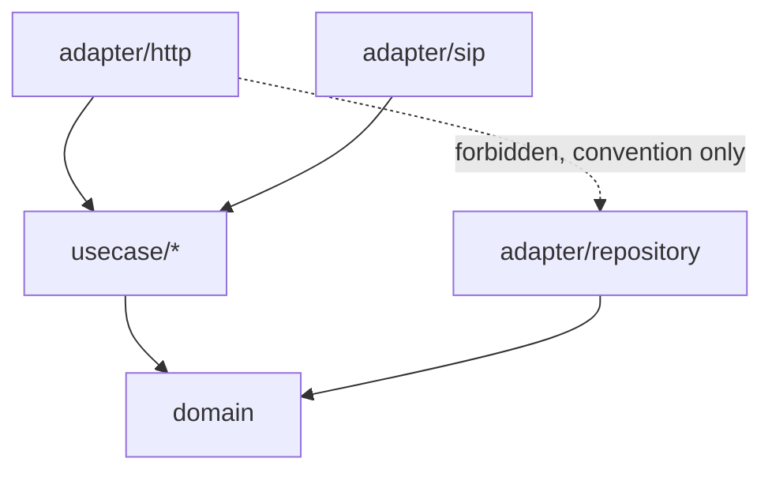

# Structure

## TL;DR

Monorepo: a Go backend (`backend/`) in clean/hexagonal-architecture style (`domain` →
`usecase` → `adapter`, dependency-inverted) behind a single `cmd/engine` composition root,
and a React/TailAdmin frontend (`frontend/`) where pages depend on a typed API client
(`lib/api`) and shared components, with `App.tsx` as the single routing source of truth.
Boundaries are convention-only — enforced by code comments, not a lint rule or test.

## Module Map

| Layer/Folder | Responsibility | Depends on |
|---|---|---|
| `backend/internal/domain` | Pure entities (`Trunk`, `Call`, `User`, `KnowledgeBase`, `Session`, `Turn`, `EmailToken`) — no framework/IO deps | nothing internal |
| `backend/internal/usecase/<name>` | Business logic per bounded context (`auth`, `call`, `conversation`, `knowledgebase`, `llmprovider`, `sttprovider`, `trunk`, `ttsprovider`); each declares its own `Repository`/`Service` port interfaces | `domain` only |
| `backend/internal/adapter/<name>` | Concrete implementations of usecase-declared ports: `http` (handlers/middleware), `repository/postgres`, `sip`, `stt/elevenlabs`, `tts/elevenlabs`, `llm/openaicompat`, `embedder/openaicompat`, `vectorstore/pgvector`, `mail` | `usecase` + `domain` |
| `backend/internal/config` | Process configuration loading | — |
| `backend/internal/pkg/<name>` | Cross-cutting, dependency-free utilities (see below) | — |
| `backend/cmd/engine` | Composition root / single binary entrypoint — the only place every layer is imported together | all of the above |
| `frontend/src/lib/api` | Typed API client layer (`client.ts`, `types.ts`, one file per resource) | nothing in `pages`/`components` |
| `frontend/src/components` | Reusable UI: `auth` (route guards), `layout` (AppLayout/AuthLayout), `shared`, `ui` (TailAdmin primitives) | `lib/api` (guards only), `utils` |
| `frontend/src/pages/main/<feature>` | Route-level screens per feature, composed from `lib/api` + `components` | `lib/api`, `components` |
| `frontend/src/App.tsx` | The only route table in the app — maps URL paths to page components, wrapped in `ProtectedRoute`/`GuestRoute`/`AppLayout`/`AuthLayout` | all page components |

## Layering rules

**Backend:** `domain` has no outward dependencies; `usecase` depends only on `domain` and
declares the interfaces (ports) it needs for persistence/external services; `adapter`
implements those usecase-defined interfaces and depends on `usecase`+`domain`, never the
reverse. Stated explicitly in code: "adapter depends on the usecase, not the other way
around" (`backend/internal/usecase/trunk/interfaces.go:30`). `cmd/engine` is the only place
all layers are imported together (`backend/cmd/engine/main.go:21-37`).

**Frontend:** `pages` depend on `lib/api` (data) and `components` (presentation); `lib/api`
depends on neither; `components/ui` is consumed by pages, not the reverse.
`frontend/src/App.tsx` is confirmed the only file containing `<Route path=` declarations —
a repo-wide grep for it elsewhere returns zero matches.

## Enforcement

**Convention-only** — no `golangci-lint`/`depguard` config or custom architecture-boundary
test was found in either `backend` or `frontend`. The inversion rule is documented via code
comments only (e.g. `backend/internal/usecase/trunk/interfaces.go:30`). This is a drift risk
worth knowing: nothing stops a future change from importing `adapter` into `usecase`.

## Design patterns identified

| Pattern | Where | Notes |
|---|---|---|
| Dependency Inversion / Ports & Adapters (hexagonal) | `backend/internal/usecase/trunk/interfaces.go:13-29`, wired in `backend/cmd/engine/main.go` | usecase declares `Repository`/`Service` interfaces; adapters implement them |
| Composition root | `backend/cmd/engine/main.go:46` (`run()`) | single `main()` wires every adapter + usecase |
| Provider abstraction for swappable external services | `backend/internal/adapter/{llm/openaicompat,stt/elevenlabs,tts/elevenlabs}` paired with `usecase/{llmprovider,sttprovider,ttsprovider}` | each provider kind is a standalone, reusable, FK-referenced resource — see [../../topics/providers](../providers/README.md) |
| Route guards as composition (React) | `frontend/src/App.tsx` (`ProtectedRoute` wraps `AppLayout`, `GuestRoute` wraps `AuthLayout`) | guard logic lives at the route-tree level, not per-page |
| Resource-per-file API client | `frontend/src/lib/api/{trunks,calls,knowledge-bases,...}.ts` sharing `client.ts`/`types.ts` | one file per backend resource |
| Title+divider card as the standard feature-page section wrapper | `frontend/src/components/shared/component-card.tsx` | see [../cross-cutting/frontend-conventions](../cross-cutting/frontend-conventions/README.md) |

## Small utility packages (`backend/internal/pkg/*`)

| Package | Purpose |
|---|---|
| `apperror` | Structured application error types/codes shared by `usecase` and `adapter` |
| `crypto` | Field-level encryption (`FieldCipher`, AES-256-GCM) for secrets at rest |
| `keygen` | Generates/hashes bearer tokens (sessions, email-verify, password-reset) |
| `logging` | Centralized structured logger setup |
| `password` | bcrypt password hashing/verification |
| `textextract` | PDF text extraction + sanitization for knowledge-base document uploads |

## Excluded: unrouted frontend demo pages

`frontend/src/pages/main/{calendar,coming-soon,forms,tables}` have zero matching `<Route>`
in `frontend/src/App.tsx` — they are unused TailAdmin template/demo content, not part of the
real product. Not documented individually; see `index.md`'s enumeration table.

## See Also
- [../dependencies/README.md](../dependencies/README.md)
- [../cross-cutting/frontend-conventions/README.md](../cross-cutting/frontend-conventions/README.md)
