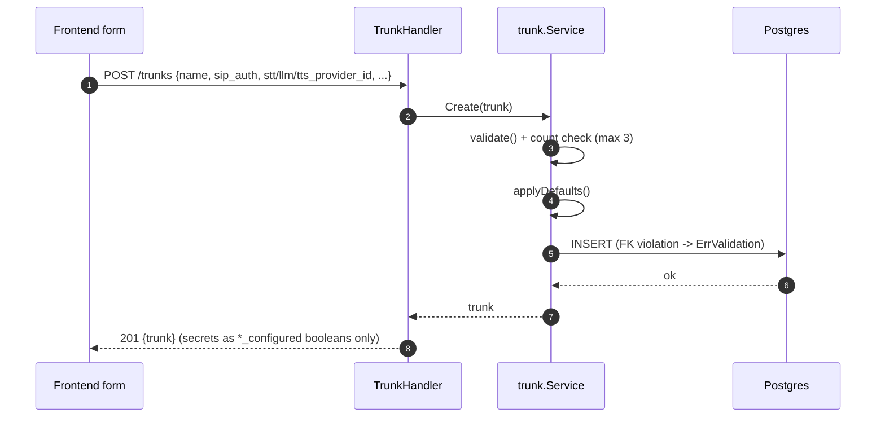

# Trunks

## TL;DR

A trunk is the admin-plane configuration resource for one SIP trunk: auth rules, a reference
to one STT/LLM/TTS provider each (by ID, not inline config), a system prompt, and
answer-mode/webhook settings. **This spoke covers only the CRUD resource** — the live
call-handling runtime that reads a trunk per INVITE is a separate topic, see
[../calls/README.md](../calls/README.md).

## Entry Points

- `POST/GET/GET{id}/PUT{id}/DELETE{id} /trunks` — `backend/internal/adapter/http/handler/trunk_handler.go:25-29,177-242`
- Frontend list/new/edit: `frontend/src/pages/main/trunks/{index,new,edit}.tsx`,
  shared form `frontend/src/pages/main/trunks/trunk-form.tsx`, schema `schema.ts`

## Sequence — Create



1. Handler decodes the envelope into `trunkRequest`, maps to `domain.Trunk` —
   `trunk_handler.go:177-184,155-175`.
2. `usecase/trunk.service.Create` validates (`validate`) — `service.go:22-23,127-154`.
3. Counts existing trunks; rejects with `ErrTrunkLimitExceeded` if `count >= domain.MaxTrunks`
   (3) — `service.go:27-36`, constant at `domain/trunk.go:12`.
4. `applyDefaults` fills zero-valued fields (`MaxConcurrentCalls`, `AnswerMode`,
   `WebhookTimeoutSeconds`, normalizes nil slices) — `service.go:38,98-125`.
5. Assigns a new UUID + timestamps — `service.go:40-43`.
6. `repo.Create` encrypts the digest password, inserts the row referencing provider IDs; maps
   an FK violation (Postgres `23503`) to `ErrValidation` — `trunk_repo.go:35-71`.
7. Handler responds 201 with `toTrunkResponse(t)`, which never echoes secrets, only
   `*_configured` booleans — `trunk_handler.go:63-116,189`.

## FK-resolution-at-read-time pattern (Get / List / FindByInboundMatch)

A trunk row only persists `stt_provider_id`/`llm_provider_id`/`tts_provider_id` — **not** the
resolved STT/LLM/TTS config. On every read, `selectTrunkColumns` does a 3-way `INNER JOIN`
against `stt_providers`/`llm_providers`/`tts_providers` in a single query
(`trunk_repo.go:168-181`), safe because the FK columns are `NOT NULL` with
`ON DELETE RESTRICT` — a trunk can never reference a nonexistent provider row
(`trunk_repo.go:165-167`). `scanTrunkRow` scans the joined provider columns directly into
`t.STT`/`t.LLM`/`t.TTS` and decrypts their encrypted API keys in place
(`trunk_repo.go:198-227`). **Purpose:** the live SIP call path (`FindByInboundMatch`) gets a
fully resolved `domain.Trunk` in one query, with zero extra round-trips per call
(`trunk_repo.go:20-25,161-164`).

## Schema

`domain.Trunk` (`backend/internal/domain/trunk.go:155-199`):

**Persisted** (in `trunks` table): `ID`, `Name`, `SIPAuth.{AllowedIPs,DigestUsername,DigestPassword(encrypted)}`,
`STTProviderID`, `LLMProviderID`, `TTSProviderID`, `SystemPrompt`, `KnowledgeBaseIDs`,
`MaxConcurrentCalls`, `AnswerMode`, `RingDelaySeconds`, `WebhookURL`, `WebhookTimeoutSeconds`,
`CreatedAt`, `UpdatedAt`.

**Resolved-at-read-time, NOT persisted on the trunk row**: `STT STTConfig`, `LLM LLMConfig`,
`TTS TTSConfig` — explicit comment: *"STT/LLM/TTS are resolved from {STT,LLM,TTS}ProviderID
by the repository, not persisted on this row — never set these directly except from a repo's
scan function."* (`domain/trunk.go:165-170`).

`MaxConcurrentCalls` is persisted but enforced only in-memory by `adapter/sip`'s Admission,
never by the DB (`domain/trunk.go:181-185`).

## Validation rules

All in `usecase/trunk/service.go` `validate()` (`service.go:127-154`), returning
`apperror.ErrValidation` with a `reason` detail:

| Rule | Reason |
|---|---|
| `name` required | "name is required" |
| `stt_provider_id`/`llm_provider_id`/`tts_provider_id` required (`uuid.Nil` check) | per-field "X_provider_id is required" |
| SIP auth: at least one of `allowed_ips` or `digest_username` | "sip_auth requires at least one allowed IP or digest credentials" |
| `max_concurrent_calls`, `ring_delay_seconds`, `webhook_timeout_seconds` must not be negative | per-field |
| `answer_mode` must be `"auto"` or `"webhook"` (only checked if non-empty) | |
| `webhook_url` required when `answer_mode == "webhook"` | |

Separate from `validate`: trunk-count limit (`count >= domain.MaxTrunks`, 3) →
`ErrTrunkLimitExceeded`, enforced only in `Create` (`service.go:31-36`).

**Frontend/backend mismatch, flagged not assumed:** the Zod schema
(`frontend/src/pages/main/trunks/schema.ts:17-47`) does NOT replicate the backend's
"allowed_ips or digest_username" rule client-side — a comment there explains both-empty is
treated as a valid catch-all/default-trunk config for `FindByInboundMatch`. Worth confirming
behavior if this path is ever exercised, since the backend's own `validate()` would still
reject it if both are truly empty.

## Failure & State

- Invalid/nonexistent provider ID (FK `23503` on any of the three provider-ID columns) →
  `apperror.ErrValidation` with `reason: "<field> does not reference an existing provider"`,
  via `mapProviderFKViolation` (`trunk_repo.go:237-254`), called from both `Create` and
  `Update`.
- Update/Delete of a nonexistent trunk ID → `apperror.ErrNotFound` (`RowsAffected() == 0` check,
  `trunk_repo.go:135-148`).
- **Delete-while-referenced → `ErrConflict`: not found in this code.** `Delete`
  (`trunk_repo.go:141-150`) has no FK-violation handling, and no other table was found with a
  FK pointing at `trunks.id` in the files examined — flagged as an open question, not assumed
  to exist or not exist. Confirm against the full migration file if this matters.

## Data

Sanitized example create request:

```json
{
  "name": "Primary SIP trunk",
  "sip_auth": {
    "allowed_ips": ["203.0.113.10", "203.0.113.11"],
    "digest_username": "trunk-user",
    "digest_password": "<redacted-credential>"
  },
  "stt_provider_id": "<uuid>",
  "llm_provider_id": "<uuid>",
  "tts_provider_id": "<uuid>",
  "system_prompt": "You are a helpful voice assistant...",
  "knowledge_base_ids": ["<uuid>"],
  "max_concurrent_calls": 1,
  "answer_mode": "auto",
  "ring_delay_seconds": 0
}
```

Response never echoes secrets — only `*_configured` booleans and the resolved provider info:

```json
{
  "trunk": {
    "id": "<uuid>",
    "name": "Primary SIP trunk",
    "sip_auth": { "allowed_ips": ["..."], "digest_username": "trunk-user", "digest_configured": true },
    "stt_provider_id": "<uuid>",
    "stt": { "provider": "elevenlabs", "model": "model-x", "api_key_configured": true },
    "llm": { "provider": "openai_compatible", "base_url": "https://api.example.com/v1", "model": "gpt-x", "api_key_configured": true },
    "tts": { "provider": "elevenlabs", "voice_id": "<id>", "model": "model-y", "api_key_configured": true },
    "max_concurrent_calls": 1,
    "answer_mode": "auto"
  }
}
```

## Gotchas

- Never set `Trunk.STT`/`.LLM`/`.TTS` directly outside a repo's scan function — they're
  resolved-at-read-time, not real columns. Writing them has no effect on persistence.
- The 3-trunk limit is enforced only in `Create`, not as a DB constraint — don't rely on the
  database to catch a 4th trunk if a new write path is ever added that skips the usecase layer.
- The delete-while-referenced→Conflict gap above is worth a quick check before assuming
  trunk deletion is safe in all cases once other resources start referencing trunks by FK.

## See Also
- [../providers/README.md](../providers/README.md)
- [../calls/README.md](../calls/README.md)
